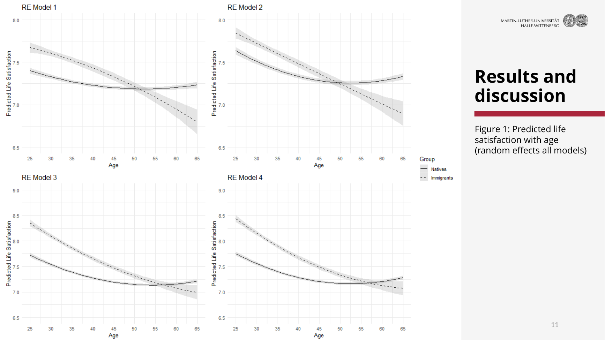
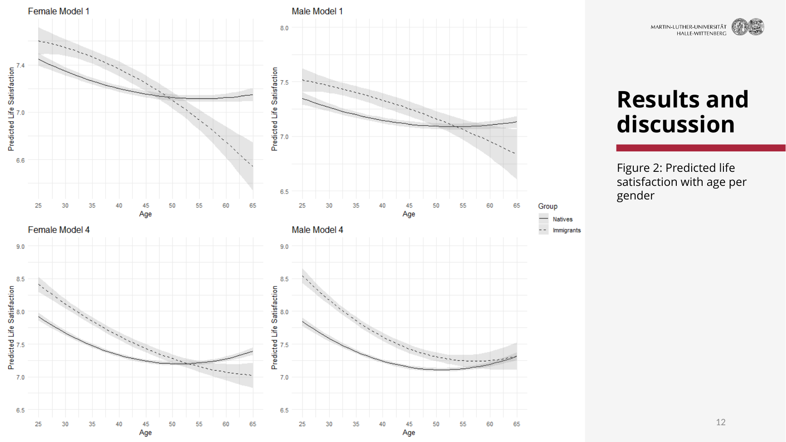

# Immigrant Assimilation & Life Satisfaction in Germany

**Panel-data analysis in R using the German Socio-Economic Panel (SOEP), 2000–2020**

**R · Data Cleaning · Data Transformation · Panel Data · Pooled OLS · Random Effects · Cluster-Robust Standard Errors · Data Visualization**

## Project overview

This repository is a portfolio version of my 2024 Master's thesis in Economics / Data Science at Martin-Luther-Universität Halle-Wittenberg.

The project investigates how the life satisfaction of immigrants in Germany develops with **years since migration (YSM)** and how it compares with the life satisfaction of native-born Germans.

The purpose of this repository is to demonstrate the technical workflow behind the empirical analysis: importing and merging longitudinal survey data, cleaning and transforming variables, constructing an analysis sample, estimating panel-data models, and visualizing model results.

## Technical highlights

- Imported and combined multiple SOEP datasets using person ID and survey year
- Cleaned labelled survey data and recoded SOEP-specific missing-value codes
- Built analysis variables for migration background, years since migration, income, education, employment, marital status, age groups, and country-of-origin groups
- Applied sample restrictions and outlier treatment
- Constructed an **unbalanced panel with 171,212 person-year observations from 28,829 respondents**
- Estimated **Pooled OLS** and **Random Effects** specifications
- Used **cluster-robust standard errors at the individual level**
- Compared nested model specifications and evaluated model fit
- Performed subgroup analyses by gender and country-of-origin group
- Produced descriptive and model-based visualizations in R

## Research question

> How does the life satisfaction of immigrants and native-born people in Germany evolve over time, and how is immigrants' life satisfaction associated with years since migration?

## Data

The analysis uses the **teaching edition of the German Socio-Economic Panel (SOEP), version 37**, covering the years **2000–2020**.

The final analytical dataset is an unbalanced panel containing:

- **171,212 person-year observations**
- **28,829 individuals**
- **21 survey years**
- 140,778 native observations
- 30,434 immigrant observations

The SOEP microdata are **not redistributed in this repository** because access and use are subject to SOEP data conditions. 

## Empirical approach

The analysis estimates four increasingly rich specifications using both pooled OLS and random-effects models.

Core explanatory variables include:

- Age and age²
- Migration background
- Years since migration and YSM²
- Gender
- Marital status
- Education
- Equivalized household income
- Employment status

The models use cluster-robust standard errors at the individual level. Additional analyses compare results by gender and by country-of-origin group.

## Selected results

Across the model specifications, immigrant life satisfaction is generally higher at younger ages but declines more steeply with age than that of native-born respondents. The estimated profiles converge around middle age, with the exact crossing point depending on the model specification.



A separate gender analysis shows different convergence patterns for female and male immigrants.



These results should be interpreted as **conditional associations rather than causal effects** because of the observational design and model assumptions.

## Repository structure

```text
immigrant-life-satisfaction-r/
├── README.md
├── .gitignore
├── master_thesis_analysis.Rmd
├── predicted_life_satisfaction_age.png
└── predicted_life_satisfaction_gender.png
```

## R packages used

The analysis uses packages including:

`tidyverse`, `haven`, `plm`, `lmtest`, `sandwich`, `table1`, `stargazer`, `marginaleffects`, `ggrepel`, `patchwork`, `performance`, `clubSandwich`, and related supporting packages.

## Running the project

1. Obtain authorized access to the SOEP teaching data.
2. Clone this repository.
3. Set `SOEP_DATA_PATH` to the local SOEP teaching-data directory.
4. Open `master_thesis_analysis.Rmd` in RStudio.
5. Install the required packages if they are not already available.
6. Run the analysis sections or knit the document.

Example:

```r
Sys.setenv(SOEP_DATA_PATH = "path/to/soep-teaching-v37")
```

## About this portfolio version

This repository is based on the code developed for my Master's thesis. For public portfolio use, internal university network paths were removed and the underlying restricted microdata are excluded. The analysis logic, statistical methods, and visualizations are based on the original thesis workflow.

## Author

**Elena Birkner**  
M.Sc. Economics – Data Science & Policy  
Martin-Luther-Universität Halle-Wittenberg
